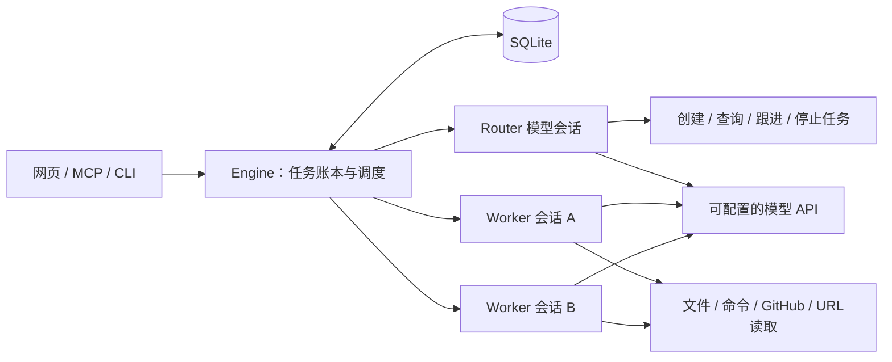

# Superagent · 个人多任务助理

一个可独立运行的网页助理：Router 理解请求和协调任务，多个 Worker 使用真实模型与本机工具完成工作。支持在同一个聊天同时安排多件事、继续原任务、查看执行证据，以及从 MCP/命令行操作同一批任务。

**没有固定业务场景，没有模拟回答回退。** 模型通过 OpenAI 兼容的 Chat Completions API 接入。默认 GLM，可切换端点和模型；不需要 Hermes、DeepSeek Harness、Docker 或 Colima。

## 启动

需要 Node.js ≥ 22.13。代码任务还需要 Git；GitHub 任务需要安装并登录 `gh`。目标项目需要的语言与测试工具由本机提供。

```sh
cp .env.example .env
# 编辑 .env：填写 MODEL_API_KEY，必要时修改 MODEL_BASE_URL 和 MODEL_NAME。
npm start
```

打开 <http://127.0.0.1:4317>。服务只监听回环地址。没有密钥时页面会提示配置，提交任务会明确失败，不生成假结果。已有环境变量可直接使用，不必创建 `.env`。

### 切换端点和模型

可以设置独立环境变量：

```dotenv
MODEL_BASE_URL=https://your-provider.example/v1
MODEL_NAME=your-model-name
MODEL_API_KEY=your-key
```

`MODEL_BASE_URL` 是接口前缀，程序会自动追加 `/chat/completions`；接口与模型需支持工具调用。系统中已经设置的环境变量优先于 `.env`，切换配置后要重启服务。

也可以复制 `config.example.json` 为 `config.local.json`，编辑：

```json
{
  "baseUrl": "https://your-provider.example/v1",
  "model": "your-model-name",
  "apiKeyEnv": "MODEL_API_KEY",
  "maxTokens": 8192,
  "timeoutMs": 120000
}
```

密钥仍放在环境变量或本机 `.env`；配置文件只引用变量名。`config.local.json` 和 `.env` 已被 Git 忽略。`ASSISTANT_CONFIG` 可指定另一个配置文件路径。修改配置后重启服务；各任务模型调用记录保留实际返回的模型名。

端点和模型等参数优先级：`MODEL_*` 环境变量 → JSON 配置 → `GLM_*` / 默认配置。密钥优先使用 JSON 明确指定的 `apiKeyEnv`；未指定时使用 `MODEL_API_KEY`，仅默认 GLM 端点可以沿用 `GLM_API_KEY`。切换供应商不会自动转发旧 GLM 密钥。通用模型不默认发送 GLM 的专有参数。需要时可配置 `thinking`、`reasoningEffort`、`extraBody`；使用 `max_completion_tokens` 的接口可设置 `maxTokensField`。不同供应商的“兼容”范围不同，先运行真实接口检查。

```sh
npm run test:model
```

该检查让模型调用工具读取随机临时文件，再准确回传内容，使用真实额度。它不会调用 Hermes，也不把密钥或随机校验内容写入仓库。当前 GLM 端点的实际验证见 [阶段 1 证据](docs/evidence/v3-stage1.json)；不代表任意端点都已经实测。Coding 套餐的使用范围、并发和额度以供应商规则及账号实际响应为准。

## 使用

在总聊天直接提出目标，例如指定仓库 URL、需要修改的问题、资料路径和交付方式。Router 将独立目标交给不同 Worker；默认最多两个 Worker 同时运行。缺少信息时会提问，正常完成会直接交付。

- 在总聊天说“刚才的任务再补一个测试”，由 Router 找回任务。
- 在任务详情直接补充，明确投递给该 Worker。
- 长命令转为后台作业，完成事件或新消息唤醒 Worker，不需要模型持续轮询。
- 停止会终止当前执行，不撤销已经发生的文件、提交或 PR 操作。
- 失败、停止或重启中断后，可继续原任务；Task ID 不变，新建 Run，保留历史与目录。

本机文件/命令工具沿用当前用户权限。独立目录和 Git worktree 用于避免并发覆盖，**不构成操作系统安全隔离**。只有明确需要修改仓库的任务才应准备工作副本。GitHub 的真实权限错误会保留在执行结果里，不模拟成功。

## 命令行与 MCP

先启动网页服务，终端适配器不会另起服务：

```sh
node scripts/client.mjs ask '阅读指定项目的 README，整理运行指南'
node scripts/client.mjs tasks
node scripts/client.mjs task task_ID
node scripts/client.mjs followup task_ID '补充安装失败时的排查方法'
node scripts/client.mjs stop task_ID
```

`ask` 支持 `--conversation chat_ID` 继续总聊天。`ASSISTANT_URL` 可以指定另一个本机端口。

在支持 stdio MCP 的 Agent 客户端配置（替换为本机绝对路径）：

```json
{
  "mcpServers": {
    "personal-assistant": {
      "command": "node",
      "args": ["/absolute/path/super-agent-demo/scripts/mcp.mjs"],
      "env": { "ASSISTANT_URL": "http://127.0.0.1:4317" }
    }
  }
}
```

提供 `submit_request`、`list_tasks`、`get_task`、`followup_task`、`stop_task` 五个工具。网页、CLI 和 MCP 使用相同数据库与任务 ID。MCP 提交返回表示收到请求，实际完成状态需查询。

## 架构



- `Conversation`：一个总聊天，可以关联多个 Task。
- `Task`：长期保存的目标、消息、工作目录和当前状态。
- `Run`：一次具体执行，包括模型调用、工具参数、结果、用量与错误。
- `Agent Loop`：模型返回工具调用 → 程序真实执行 → 工具结果回传 → 模型继续。
- `Inbox`：新增消息整批持久化，在模型步骤边界读取；停止清理中的跟进等待旧执行退出后续办。
- `History`：长会话归档，按需读取；长输出保存到任务 `.agent-logs` 文件，可分页恢复证据。

Router 只注册协调工具，Worker 才注册执行工具。调度与状态由程序维护，不靠模型自己记住队列。参考 [DeepSeek 官方研究原型](https://github.com/deepseek-ai/dsh-superagent-prototype)，独立实现本机个人版。

## 验证与演示

```sh
npm test                 # 自动回归：模型协议用测试替身，文件/进程/HTTP/MCP真实执行
npm run test:model      # 真实模型工具往返
npm run test:assistant  # 真实 Router + 双 Worker + 语义续办 + 重开数据库验证
```

后两项会产生模型调用，失败时不会回退为模拟结果。六个演示用例与证据要求见 [演示指南](docs/demo-v3.md)，阶段记录见 [实施记录](docs/implementation-v3.md)。

`data/assistant.sqlite` 保存新版本状态，`data/workspaces/` 保存任务目录与日志；均不提交 Git。重启不意味着后台进程自动原地恢复：未确认完成的任务标记中断，继续时先核对已有操作。当前为单控制进程、本机执行，不提供云端 BYOM 或分布式 exactly-once 保证。

## 代码入口与历史版本

| 文件 | 用途 |
| --- | --- |
| `server/index.js` | 启动本机服务；旧 handler 仅供 v2 回归 |
| `server/assistant.js` | Router、Worker、任务与持久化 |
| `server/http.js` | 网页与任务 API、产物下载 |
| `server/agent/model.js` | 模型配置与 Chat Completions 适配 |
| `server/agent/loop.js` | 通用模型工具循环 |
| `server/agent/tools.js` | 文件、异步命令和 URL 工具 |
| `scripts/mcp.mjs` / `client.mjs` | 终端入口 |

`server/engine.js`、`provider.js`、`executor.js`、`runtime/` 和 Colima 脚本是 v2 历史实现，新版启动路径不调用它们。旧文档与 `public/share/` 演讲材料描述固定流程版本，不代表本版能力或验证结果。
