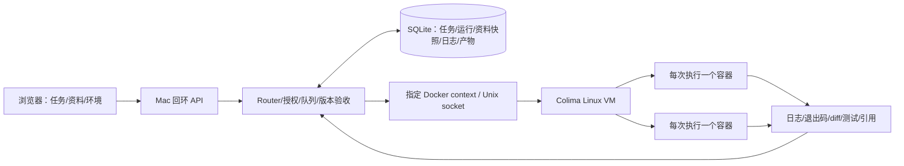

# 第二版：Colima 执行主机与实用操作台

日期：2026-11-07。依据本地原片全量转写、关键帧和官方材料修订。原片分析见 [video-analysis-v2.md](video-analysis-v2.md)。

## 设计判断

Colima 可模拟独立 Linux 执行端。视频 12:48–13:13 介绍的是 Agent Loop 与代码/工具链环境分离，支持 BYOM，不限定代码必须在云服务器。12:45画面及13:21–13:32语音明确完整云端方案并未在视频中部署验证。

本版采用：

控制端仍在 Mac，执行端位于 Colima Linux VM。两者不是独立物理主机，Mac 休眠/断电会同时影响它们；这是执行隔离与协议拓扑的验证，不是云端高可用部署。

## 本版已实现的路径

| 路径 | 实际行为 | 不宣称的能力 |
|---|---|---|
| 代码修复 | 容器复制订单服务夹具；真实运行三项测试复现一项失败；实际修改源码；再次运行三项测试；返回真实输出和差异 | 不读取公司仓库，不是能自动修任意缺陷的通用编码智能体 |
| 知识问答 | 从 UI 导入 Markdown/文本，选取资料；容器对实际正文做中文双字/英文关键词检索，输出相关原文及来源 | 不把关键词匹配称为语义 RAG 或模型推理 |
| 资料报告 | 容器根据实际选取文档排序、摘录并生成 Markdown | 不编造未记载的进展、负责人或日期 |
| 任务管理 | 创建、搜索、筛选、暂停、恢复、取消、失败重试、跟进、按版本验收 | 不自动发布到企业平台 |
| 执行观测 | 实时日志、历史 run 选择、Linux 主机/容器、测试前后状态、产物下载 | 不把静态动画当执行进度 |
| 模型适配 | 保留上一版显式选择的本地 DeepSeek 文本草案模式 | 默认 Colima 工作流不调用模型；未声称验证真实模型质量 |

这些工作流是实际运行的受控程序。用户正文不插值为 Shell，也不会执行文档中附带的命令。任意新要求会保存为任务上下文；只有已实现的工作流支持的行为会执行。

## Task 与 Run 的生命周期

- Task 保存初始授权、来源线程、修订号、资料快照和最终验收状态。
- Run 对应一次 Assignment，保存唯一 ID、任务 ID、修订号、容器身份、开始/结束时间、日志、错误、真实执行证据与当次产物。
- 重试不改变 task ID，新建 run ID；同一修订重试也不会复用容器名。
- 新跟进使在途结果失效；结果回写时同时检查 task状态、revision、runId，迟到结果不能覆盖新要求。
- 暂停运行时中止当前容器，恢复后新建执行，不承诺在任意指令位置保存进程快照。
- 控制端崩溃后，未确定完成的 run 标为 interrupted，task 标为 failed；清理旧容器后由人显式重试，不静默宣称成功。
- 清理失败持久保存 cleanupPending/cleanupError。新派工前先清理，未确认则失败并阻止创建新容器。
- 创建请求超时或控制端在创建阶段中断时持久记录 creationUncertain；单次检查不存在不能证明旧请求不会稍后完成。只有确认实际清理后解除；一直找不到对象的极端情况需人工诊断，当前不提供自动解除按钮。
- 已验收任务收到跟进会回到队列，新产物必须重新按当前版本验收。
- 资料在创建任务时快照化，之后删除或新增资料不会悄悄改变既有任务依据。使用新资料应创建新任务。

持久记录不等于分布式 exactly-once：当前是单控制进程与一台 VM，没有跨多控制器租约。故障恢复采取保守失败与显式重试。

## 执行环境约束

专用 profile 为 `superagent-demo`，Docker context 为 `colima-superagent-demo`。不会切换用户既有默认 context。Colima 启动禁用 home 挂载、SSH agent 转发、修改用户 SSH 配置和额外端口转发。

每次容器：

- 固定镜像与固定入口程序；先 create，确认对象后再 start -ai。
- `--network none`；任务不联网，不挂载 host 目录或 Docker socket。
- 只读根文件系统，`/work` 和 `/tmp` 是限额临时内存目录。
- UID/GID 1000，capabilities 全移除，no-new-privileges。
- 每容器 1 CPU、256 MiB、64 PID，执行期限 60 秒；控制层最多两个并发槽。
- `--pull never`，任务不隐式下载镜像；镜像仅在显式准备脚本中构建。
- 取消在 create 阶段不会启动容器；创建结果不明或清理失败明确保留待核对状态。
- 日志和输入限额，UTF-8 跨块解码，避免输出耗尽控制服务内存或损坏中文。

这些约束限于本项目设置。仍未做恶意内核攻击、容器逃逸或完整企业威胁模型测试，不能作为承载任意不可信代码的认证隔离平台。

## 操作页面取舍

移除营销标题、场景说明卡和长架构页。只保留三个工作区：

1. 任务：搜索/筛选、列表、执行详情，查看日志、产物和对话；按 run 回看历史。
2. 知识资料：导入/粘贴、预览、删除、创建任务时选取。
3. 运行环境：连接状态、镜像/context、检查按钮及启动指引。

解释性资料放在本目录文档；页面上的短标记说明旧版模板、真实容器或模型草案，避免混淆。

## 企业演进顺序

本版代码完成范围是单机 Colima 的可运行闭环，不需要公司账号或新服务器。

1. 接测试仓库：用固定仓库副本替换夹具，增加结构化补丁接口、依赖镜像与测试配置。当前不接受任意 shell。
2. 接企业模型：将源码/检索证据送入获准模型，输出结构化补丁或答案；工具执行仍在独立容器，模型权限不等于控制进程权限。
3. 接身份与知识权限：SSO/平台签名身份、文档 ACL、审计保留和企业密钥代理；本机 Alice/Guest 仍是模拟身份。
4. 接真正远程执行端：替换 Executor transport，保留 task/run协议，加入双向认证、出站连接、租约、心跳、断线恢复和幂等结果确认。不能直接把本机 API 暴露到公网。
5. 上生产前：固定业务评测、失败注入、人工验收、容量预算和运维责任。Watchdog 可以先做确定性超时/进展检测，不赋予其自行扩权和任意改配置的权限。

不在本轮自动创建外部连接器、Webhooks、常驻服务、无人值守发布或公司系统写回。
