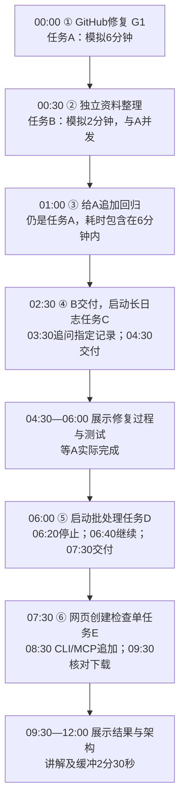

# 六场景连续演示流程与模拟耗时

以下为12分钟演示编排假设，不是实测、服务承诺或模型耗时预测。假设依赖已准备、无需澄清；现场必须等实际任务状态，不能按时间声称完成。

时间表示观众看到的演示顺序，箭头不表示前一个任务已经结束。任务A与B/C同时执行，最多两个Worker；任务3复用A，不创建第三个Worker。场景5包含停止与恢复时的模型检查耗时，批处理脚本本身约需60秒，其他时间为演示假设。场景6需要切换终端或MCP；其余提问都在同一总聊天中。

完整输入与公开issue见[具体任务清单](demo-catalog-v3.md)。GitHub草稿PR发布可另行演示，未计入本时间安排。网络、安装依赖、测试失败、模型响应和人工讲解都会改变实际时长。
