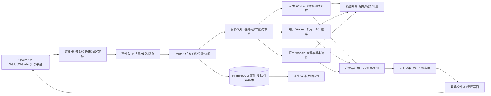

# Superagent：研究结论与企业可行性方案

> 第一版历史快照。2026-11-07 已获得原始音视频并升级为 Colima 真实执行版；当前状态请看 [原片复核](video-analysis-v2.md) 与 [第二版架构](architecture-v2.md)。下文关于字幕未取得和纯模板实现的描述只反映第一版当时状态。

核查日期：2026-11-07（Asia/Shanghai）。本报告对应本目录独立实现的 Superagent Lab，不是 DeepSeek 官方产品或官方仓库的部署。

## 1. 结论

值得做小范围、可审计的公司试点。最有价值的变化是：把人工在多个会话间追踪进度、转述上下文、催办和验收的工作，变成系统能力。用户围绕业务任务工作，底层会话变成实现细节。

用户选择的首期方向为 **研发协作 + 内部知识与报告**。本地演示证明事件接入、准入规则、同线程续办、独立上下文、持久任务、异步推进与审批可以组成闭环；它不证明真实模型能可靠修复公司代码，也不证明企业知识权限已经落实。

建议先“只读分析和草稿交付”，通过质量与权限评测后再接入受控写回。不要直接把官方研究原型部署成公司的生产机器人。

## 2. 视频分析及证据边界

指定视频：[DeepSeek Super-Agent 架构浅析：让系统接管会话管理](https://www.youtube.com/watch?v=acMNm0vNoKA)，频道 01Coder，页面显示发布于 2026-11-02，时长 17:45。

已直接读取视频标题、完整可见说明和章节。转写入口存在，但转写面板未返回文本，字幕接口返回空内容。因此下面是对**视频公开说明与章节结构**的分析，并用官方设计文章与仓库交叉核对；不是逐字字幕总结，也没有宣称完整观看、听完或独立复跑作者的三组演示。

| 视频时间 | 章节内容 | 对公司演示的启示 |
|---|---|---|
| [00:00](https://www.youtube.com/watch?v=acMNm0vNoKA&t=0s) | 为什么需要 Super-agent，以及两层架构 | 用任务台替代多个需要人盯守的聊天窗口；协调和执行分层 |
| [02:58](https://www.youtube.com/watch?v=acMNm0vNoKA&t=178s) | 事件、授权与后续消息如何流转 | 来源身份与正文分开；后续消息沿订阅关系进入既有任务 |
| [07:28](https://www.youtube.com/watch?v=acMNm0vNoKA&t=448s) | 上下文、异步执行与本地机制验证 | 记录关联对象和独立上下文；执行不阻塞新的跟进 |
| [12:23](https://www.youtube.com/watch?v=acMNm0vNoKA&t=743s) | 持续在线的设计：环境分离与 Watchdog | 生产需要持久状态、受控执行环境与独立健康监测 |
| [14:14](https://www.youtube.com/watch?v=acMNm0vNoKA&t=854s) | 性能实验、实现边界与工程启示 | 区分调度实验与真实业务收益，避免把架构愿景当成已交付能力 |

## 3. 官网、设计文章与公开原型的关系

- [DeepSeek Harness 官网](https://www.deepseek.com/en/harness/)是通用 Harness 的介绍：公开预览、开源、Cordis 插件架构、研发和办公任务、后台工作及轨迹检查。官网所示通用能力不能直接归到 Super-agent 原型名下。
- [团队设计文章](https://x.com/DeepSeekHarness/status/2116857257245987236)已通过浏览器直接读取，页面展示英文机器译文。开篇明确其讨论架构思想，不是在介绍现有 Harness 功能。文章 §1–§9 覆盖四项特性、五个模块、初步实验和未解决问题。
- [官方研究原型](https://github.com/deepseek-ai/dsh-superagent-prototype)定位为单 GitHub 仓库研发代理，可选飞书入口，独立会话与目录执行，结果回原会话。README 明确非正式产品、非生产就绪，公开版本与内部版本/文章描述不完全相同。

### 四项特性

| 特性 | 含义 | 企业中的可观察行为 |
|---|---|---|
| Continuous / 连续 | 用户跨会话、跨入口仍面对同一协作者 | Issue 跟进、聊天补充和审阅意见能找到正确任务 |
| Productive / 高效并行 | 多任务各自推进，不被一个长命令卡住 | 新问题可以进入队列；两个任务的执行记录不混杂 |
| Proactive / 事件驱动 | 根据环境事件及授权规则主动处理，其他时候安静 | CI 失败、讨论反馈触发候选事项；无关聊天不启动工作 |
| Persistent / 持续运行 | 生命周期不绑在一个交互会话上，异常后可恢复 | 重启不丢任务；需要设备的任务等环境可用后再继续 |

上述归纳来自设计文章 §1；Persistent 不等于本项目已经部署为全天候服务。

### 五个模块及理念

1. **Router / Worker 两层架构**：Router 保持全局任务关系并负责对外沟通；Worker 只处理自己的任务。Router 不必拆解每个复杂任务，也不应承担繁重执行。
2. **事件驱动**：代码先判断来源和名单，模型处理需要语义理解的候选事件。已订阅的后续事件由代码直接透传。Inline 把近期需要的信息放进窗口，Spill 把长内容留在外部；Chain of Recall 通过对象 ID 沿关联图逐跳找回历史。
3. **全双工、多渠道交互**：长任务 start/stop 与对话解耦；新输入无需等长命令结束。聊天只给必要结论，代码评审和文档给结构化证据。
4. **计算、状态与执行环境分离**：持久状态保存在数据库，Agent Loop 可以独立运行；执行环境按需连接，不必把全部环境复制进模型所在设备。
5. **外部 Watchdog**：独立控制循环同时检查系统健康与任务进展。在企业实现中，不应给它不受控扩权或改写治理规则的权限。

“尽量少占用人的注意力、尽量多交付价值”是[原型哲学文档](https://github.com/deepseek-ai/dsh-superagent-prototype/blob/main/docs/000-philosophy.md)强调的运营原则。不是每条消息都回复，也不是无限制主动执行。

### 不应误读的证据

- 设计文章 §7 使用合成消息流及模拟耗时工具，研究调度；不能推导真实研发效率或公司 ROI。文章也承认多会话会消耗更多 cache-read tokens，不能宣传“多 Agent 必然省钱”。
- 设计中 Router 可不提供 Bash，但[公开原型架构文档](https://github.com/deepseek-ai/dsh-superagent-prototype/blob/main/docs/007-architecture.md)明确其主会话仍有 Bash/read/job 等工具，不读代码是提示词约定。
- [执行文档](https://github.com/deepseek-ai/dsh-superagent-prototype/blob/main/docs/003-execution.md)明确独立目录和命令包装不构成安全边界；自动合并规则也主要由提示词治理，应依靠代码平台分支保护强制执行。
- [部署文档](https://github.com/deepseek-ai/dsh-superagent-prototype/blob/main/docs/006-deployment.md)当前只支持 github.com，不支持 GitHub Enterprise Server；执行器以操作者 OS 身份运行。公司使用 GHES/GitLab 时，连接器与部署隔离都需改造。
- [MIT 许可证](https://github.com/deepseek-ai/dsh-superagent-prototype/blob/main/LICENSE)允许按条款复用，需保留适用版权与许可；模型、依赖及连接器条款另行审查。本项目没有复制原型实现代码。

## 4. 本项目范围与对应关系

| 能力 | 本项目实现 | 边界 |
|---|---|---|
| 事件接入 | 本机 UI / JSON API 产生模拟 GitHub、飞书事件 | 未接外部轮询、机器人或 Webhook |
| 确定性准入 | 来源类型、示例 actor 名单、固定权限范围 | actor 来自演示请求；不是 SSO、签名身份或设备认证 |
| 幂等 | source + eventId 唯一 | 不承诺分布式 exactly-once |
| Router | 规则代码创建任务并按 source + thread 找回 | 无 LLM 语义分流，不自动理解跨线程关联 |
| 订阅透传 | 同线程消息进入同一任务，完成后补充会重新待审 | 简化为一线程一任务；原型支持多对多订阅，本项目未实现跨平台关联 |
| Worker | 两个并发槽、独立消息集合和产物 | 同进程异步任务，不是独立容器/VM；不执行任意命令 |
| 持久化 | SQLite 保存事件、任务、消息、审计、通知与产物 | 单机单进程；没有多副本租约和异地容灾 |
| 审批 | 本地人工验收，草案修订后需重新审阅 | 企业化增强，批准不等于 GitHub 合并或文档发布 |
| 业务草案 | 缺陷建议、知识回答、研发周报；合成资料附来源 | 默认固定模板不做任意问题推理；真实模型模式只生成文本 |
| 注意力面板 | 优先展示待验收/失败，后台轨迹可查 | 通知仅存本地；未外发到公司渠道 |
| 历史找回 | 任务内完整历史、事件和来源线程 ID | 未实现 Inline/Spill、多跳 Chain of Recall 或向量检索 |
| Watchdog | 测试恢复与状态一致性 | 未实现自主 Watchdog，也未设置常驻系统服务 |

本地未授权人员的后续事件同样被挡在准入层；官方原型允许订阅线程中的内容透传但不扩大 Mandate。本 demo 采用更严格的简化规则，并未逐项复刻原型。

## 5. 企业目标架构（建议）

### 必须由系统实现的边界

- **身份**：平台 user ID 及回调签名来自连接器，不接受消息正文的“我是管理员”。明确租户/团队/项目范围，避免全公司共用无限全局上下文。
- **知识权限**：先以用户身份检索可读文档，再把片段给模型；文档版本、访问条件与引用一起记录。不能先全库检索再让模型过滤，也不能把 Router 的全局记忆当跨部门共享库。
- **执行**：独立容器/VM、只挂载必要仓库、限制网络与工具。凭证由短期代理注入工具，不进入提示词或结果。
- **变更**：模型只提出行动；系统校验范围与动作类型。批准绑定 commit/文档版本与产物摘要，变更后旧审批失效。写回使用业务幂等键和 outbox。
- **恢复**：入队与状态持久化在同一事务；Worker 以租约认领；超时进入可诊断失败，不无限自重试。重启后查询副作用结果再重发。
- **观测**：记录排队、模型、工具、审批耗时和实际调用量；外部通知只传结果/待办/阻塞，不传完整推理与日志。

## 6. 三个场景与验收

### A. 研发协作：Issue → 修复草案

输入：测试仓库中空结果返回 null 的缺陷及复现条件。任务接受后，跟进“请保留调用方兼容性”应进入同一任务。真实试点 Worker 在隔离副本复现、改代码、运行测试，给出 diff、测试输出及风险，等待代码所有者审查。

本 demo：使用 CODE-001 合成代码夹具，生成文本补丁建议；未运行真实仓库测试。验收看幂等、任务续办、审批，不把“生成草案”算“缺陷已修复”。

### B. 内部知识：规则问答与引用

输入：“发布前需要哪些检查，P1 故障怎么处理？”真实试点检索当前用户可访问的发布规范/值班手册，回答时附版本和出处；没有证据时说明缺口。

本 demo：KB-001/KB-002 是合成制度，不代表公司政策。验收看来源可核对、后续追问连续、不同任务不串上下文。真实知识正确率、拒答率和 ACL 零泄露需另测。

### C. 报告：项目记录 → 研发周报

输入：授权范围内本周 Issue/PR/会议记录；输出交付、风险、负责人、下周计划，每项可回到来源。人工确认后才发布到指定文档位置。

本 demo：KB-003 提供合成进展，保留引用。没有真实工单连接，不会自动发周报，也没有创建定时任务。

## 7. 试点路径与投入假设

以下为规划估算，不是已完成工作、报价或工期承诺。假设 1–2 名工程师、业务负责人可参与验收、已有可用模型和测试环境。

| 阶段 | 建议范围 | 建议退出条件 |
|---|---|---|
| 当前 PoC | 合成数据、本地任务台、受控状态机 | 核心机制测试与交互验收通过；功能/模拟边界写清 |
| 第 1–2 周 | 单团队、只读测试仓库 + 一组授权知识；接身份和模型网关 | 20–50 条固定业务用例能回放；权限负例无泄露；答案和引用经负责人评分 |
| 第 3–4 周 | 允许生成 PR/文档草稿，保留人工发布 | 审批版本绑定、失败恢复、幂等写回和回滚演练通过 |
| 后续扩展 | 增加平台、部门、长任务与有限主动规则 | 有预算、值守责任、数据保留规则和量化业务收益后再扩 |

“20–50 条用例”是试点设计建议，不能证明覆盖全公司复杂度。首期不自动合并、不变更生产、不自动执行群聊中任意指令。

### 衡量可行性

- 协调机制：重复事件生成任务数、误路由率、未授权创建率、取消后继续执行数、重启恢复成功率、旧审批接受数。
- 智能质量：缺陷真实复现率、补丁通过率、引用准确率、无证据拒答质量、知识越权测试、报告事实一致性。
- 人的负担：每任务人工干预次数、通知数、需人工返工时间、从请求到可审阅产物的 p50/p95。
- 资源：真实输入/输出/缓存 token、模型调用、重试、工具运行时间、容器资源；分别记录成功和失败任务成本。

成本模型：模型实际用量 × 合同/当前价目 + 执行环境 + 存储/检索 + 运维 + 人工审阅。当前没有公司用量、模型合同价格和基线，无法给出可信 ROI、固定月费或节省百分比。

## 8. 仍需公司提供的信息

无需阻塞当前本地演示，但正式试点前要确认：代码平台是 github.com/GHES/GitLab 哪一种；知识库与 IM 平台；允许的模型和数据出网政策；试点团队与文档 ACL；可供隔离执行的环境；谁拥有审批、发布和运维责任。

完整实现与运行方式见 [README](../README.md)，演示顺序见 [demo-guide](demo-guide.md)，验收记录见 [verification](verification.md)。
